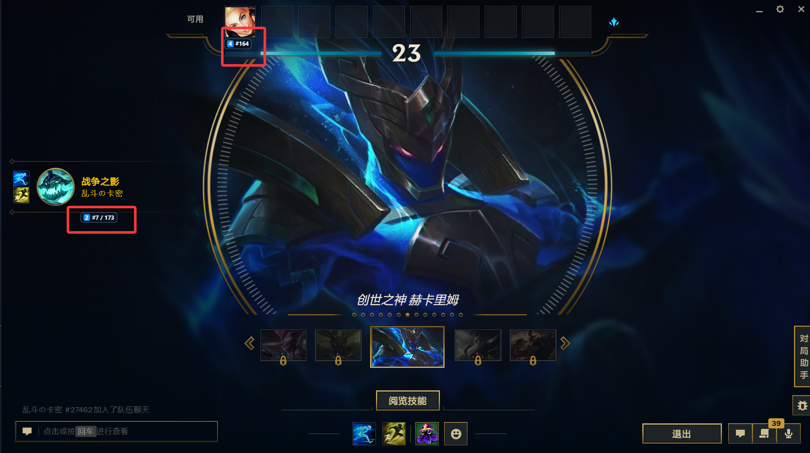
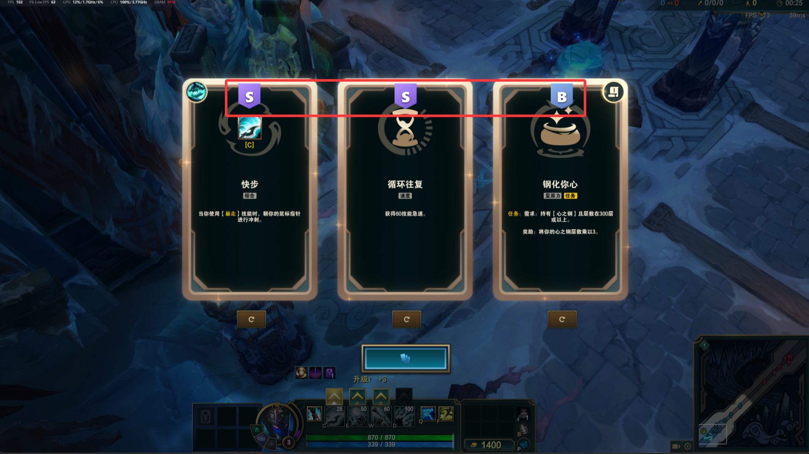

# 海克斯大乱斗小助手

简体中文 Windows 桌面助手，在《英雄联盟》极地大乱斗中显示英雄排名和海克斯推荐。应用启动后常驻系统托盘，识别和 OCR 都在本机进行。

> 当前发布：v0.1.2 免安装版。安装器暂不发布。逐条更新内容见 [更新记录](CHANGELOG.md)。

## 下载与启动

**[下载 v0.1.2 免安装压缩包](https://github.com/yeliwei01994/hextech-aram-assistant/releases/download/v0.1.2/HextechAramAssistant-0.1.2-portable.zip)**

1. 下载 ZIP 并完整解压到一个固定文件夹，不要直接在压缩包里运行。
2. 双击 `aram-companion.exe`。
3. 应用会在后台托盘运行；右键托盘图标打开设置或退出。

不需要安装 Node.js、pnpm、Rust 或 Python。OCR 运行组件已包含在压缩包内。Windows 11 和大多数 Windows 10 电脑已带有 WebView2；若程序提示缺少，可[从微软安装 WebView2 Runtime](https://go.microsoft.com/fwlink/p/?LinkId=2124703)。

## 功能预览

### 选人阶段：英雄排名

自动识别当前英雄，显示 AramHex 国服样本的海克斯大乱斗胜率名次，以及本应用按名次五等分的 1–5 档。下方截图为旧版展示。

<p align="center">
  
</p>

### 对局阶段：海克斯 S / A / B 推荐

本地识别海克斯卡片，在卡片上方显示本应用 S/A/B 评级、原始胜率、样本局数与统计建议。样本少或没有可靠数据时会明确提示；刷新卡片后会根据画面变化重新识别。

<p align="center">
  
</p>

## 使用说明

- 推荐将游戏显示模式设为**无边框**，独占全屏可能遮挡游戏内浮层。
- 快捷键：`Ctrl + Shift + F6` 手动识别海克斯，`Ctrl + Shift + F7` 刷新英雄状态，`Ctrl + Shift + F8` 隐藏海克斯提示。
- 关闭设置窗口会将应用隐藏回托盘；要完全退出，请右键托盘图标并选择“退出”。
- 解压后的程序文件夹可放在任意固定位置。卸载时退出应用并删除该文件夹；本地设置和数据保存在 Windows 用户目录中。

## 从源码运行

开发环境需要 Windows 10/11 x64、Node.js、pnpm、Rust stable、Visual Studio C++ Build Tools、WebView2 Runtime 和 Python 3.12。

```powershell
pnpm.cmd install
pnpm.cmd tauri dev
```

构建免安装压缩包：

```powershell
pnpm.cmd package:windows:portable
```

压缩包输出到 `outputs/HextechAramAssistant-版本号-portable.zip`。

## 数据与隐私

- 默认统计来源为 [AramHex 数据仓库](https://github.com/czgreat/aramhex-data)，采用国服全体样本、常规规则；内置离线快照，启动时及每 6 小时检查更新，失败后 15 分钟重试。
- 统计数据采用 CC BY-NC 4.0，需署名、仅限非商业使用。S/A/B 是本应用计算的评级，不是来源官方等级；方法与局限见 [数据说明](docs/data-sources.md)。
- 英雄联盟客户端状态读取和海克斯截图 OCR 均在本机处理，不会上传游戏截图。
- AI 阵容分析默认关闭；启用并手动触发后，才会将敌方英雄名称和手动威胁标签发送到用户配置的 API 服务。
- 本项目为社区工具，与 Riot Games、腾讯或 AramHex 无隶属关系。游戏及数据相关权利归其各自所有者。
