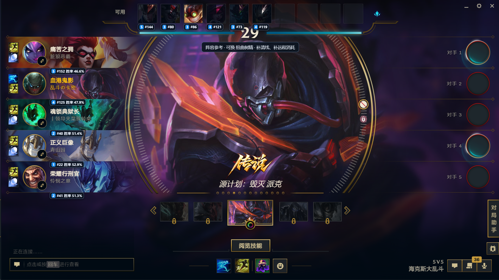
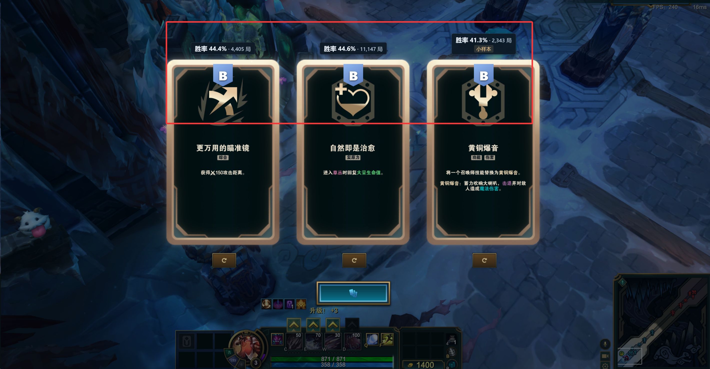
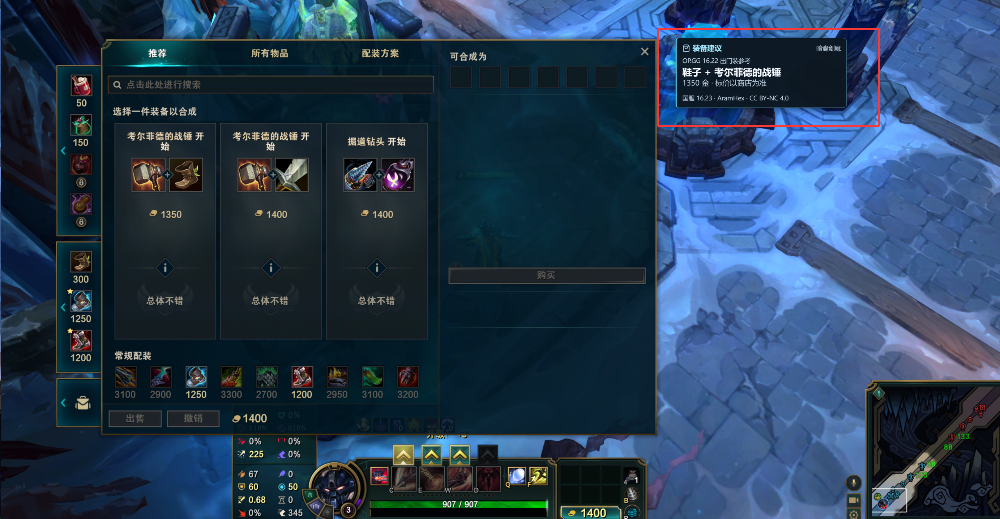

# 海克斯大乱斗小助手

简体中文 Windows 桌面助手，为《英雄联盟》国服海克斯大乱斗提供选人排名、阵容参考、海克斯评级和商店出装建议。应用启动后常驻系统托盘，游戏状态读取和画面识别都在本机进行。

> 当前源码版本为 v0.1.7。Windows 免安装包以 GitHub 已公开的 Release 为准。逐条更新内容见 [更新记录](CHANGELOG.md)。
>
> 本版修复设置页循环渲染及进局时英雄暂时未知的问题，并在 Windows 免安装版加入海克斯联动提示。

## 下载与启动

**[下载最新公开版的 Windows 免安装压缩包](https://github.com/yeliwei01994/hextech-aram-assistant/releases/latest)**

1. 下载 ZIP 并完整解压到一个固定文件夹，不要直接在压缩包里运行。
2. 双击 `aram-companion.exe`。
3. 应用会在后台托盘运行；右键托盘图标打开设置或退出。

不需要安装 Node.js、pnpm、Rust 或 Python。OCR 运行组件已包含在压缩包内。Windows 11 和大多数 Windows 10 电脑已带有 WebView2；若程序提示缺少，可[从微软安装 WebView2 Runtime](https://go.microsoft.com/fwlink/p/?LinkId=2124703)。

## 功能预览

### 选人阶段：英雄排名与阵容参考

自动读取己方五个位置和备选英雄池。己方英雄旁显示国服胜率和名次，备选池显示名次和档位。1–5 档是本应用将 AramHex 胜率名次五等分得到的档位，1 档最高。

<p align="center">
  
</p>

#### 英雄标签怎么评估

内置名册的 173 名英雄均有六项档案。标签由项目按海克斯大乱斗中的技能用途人工维护，支持数字 ID、英文 ID、中文名和称号匹配。

| 能力 | 评估内容 |
| --- | --- |
| 清线 | 能否稳定处理兵线，帮助队伍守塔或推进。 |
| 远程消耗 | 能否在正式交战前从远距离持续压低对方血量。 |
| 开团 | 能否主动发起团战，让队友有机会跟进。 |
| 反手保护 | 能否用控制、击退、护盾或救援保护队友。 |
| 前排承伤 | 能否顶住第一波伤害，给队友留出输出空间。 |
| 主要伤害类型 | 分为物理、魔法、混合和随出装变化。 |

前五项分为主要、条件性、弱或无。阵容分析使用主要能力和条件性能力。条件性能力可能依赖技能、出装或进场时机，计算时按半份能力计入。新增英雄缺少档案时，阵容分析会谨慎处理未知能力。

#### 换人建议怎么算

1. 确认自己的英雄在己方阵容中的位置，逐个模拟用备选英雄替换自己。
2. 比较换人前后的能力。规则会考虑补清线、补消耗、补开团、补反手、补承伤，以及补另一种主要伤害。消耗已充足时，反手保护的权重更高。
3. 检查换人是否让原本具备的关键能力跌破保留门槛，或失去唯一明确的物理或魔法输出来源。未知项会限制依赖该能力的判断。
4. 用有效的 AramHex 国服胜率计算换人代价。候选低于当前英雄的百分点和低于 49% 的百分点都会扣分。当前英雄缺少数据时用 50% 作为比较基准。总扣分超过 1.5 时，只有能明确补足清线，或给消耗阵容补足反手保护的候选才能继续比较。扣分后至少剩 1 分才推荐，同分优先胜率更高的候选。这些分数是规则权重。

**英雄标签和阵容建议仅供参考，仍有优化空间。** 标签、权重和门槛是人工判断，尚未用国服五人阵容对阵数据校准。建议说明换人可能补上什么，无法量化换人对本局胜率的影响。

### 对局阶段：海克斯 S / A / B 推荐

本地识别常规三张卡和新事件的四张卡。浮层按卡片位置显示 S/A/B 评级、胜率和样本局数，并标出小样本。固定位置漏检时会尝试按边框和整排布局找卡，刷新卡片后自动重新识别。

<p align="center">
  
</p>

### 对局阶段：打开商店自动显示出装建议

助手从游戏画面识别商店，确认打开后在右侧显示装备浮层。关闭商店后自动隐藏。新版加大了装备名称和购买提示的视觉权重，开局优先显示可负担的出门装或散件，后续结合已有装备与路线推荐下一件。浮层支持鼠标穿透，购买和搜索仍在游戏商店内完成。

<p align="center">
  
</p>

#### 推荐装备怎么算

- **双来源路线**：OP.GG 海克斯大乱斗页面提供出门装和核心组合，AramHex 提供国服成装样本和装备元数据。核心组合须通过本地样本校验，再根据背包匹配程度、可接散件和国服持有局数挑选。两个来源各自标注补丁，核心组合参考不代表购买顺序。
- **更新路线表**：在仓库根目录运行 `python scripts/update-opgg-builds.py`，按内置英雄名册更新 `data/seed/build-routes.json`。如需代理，可为该命令设置 `OPGG_PROXY`。读取失败时保留该英雄上次成功的数据，脚本会列出缺少路线的英雄。

- **候选数据**来自 AramHex 国服常规模式的英雄 × 成装持有统计。读取装备名称、标价和合成关系，并筛除少于 300 局、标记为低样本或数据无效的记录。
- **常规下一件**优先排除背包里已经持有的成装。候选取持有局数最高的前八件，并保留达到第一名持有局数 20% 的装备。候选中优先显示能接上更多种已有直接散件的装备，散件数量相同时再按持有局数排序。
- **本局针对装**尝试从本机对局接口读取敌方英雄。命中手工维护的回复、护盾或前排规则时，会在有足够样本的候选里考虑重伤、破盾或穿透，并显示理由。没有可靠名单或合适的候选时，仍可显示常规成装参考。
- **金币提示**使用当前金币与成装标价比较。匹配到已有散件时，浮层提示可以接散件，实际合成费用以游戏商店为准。

**装备推荐仅供参考，仍有优化空间。** 持有胜率是历史样本中对局结束时持有该装备的胜率，不能用来推断首件顺序或本局购买后的胜率。装备排序、散件匹配和敌方威胁规则仍可改进。部分显示模式、商店位置和缩放也可能影响浮层识别。

## 海克斯联动

选卡时，助手根据点击卡位和卡名识别结果记录已选海克斯，也可用 HUD 图标辅助确认。后续候选卡凑齐组合时，浮层会显示联动说明。「待实测」表示具体触发条件还需要对局验证。

<details>
<summary>展开 16.23 海克斯联动表</summary>

| 双卡 | 目前的处理 | 依据和限制 |
| --- | --- | --- |
| 虚幻武器（1029）＋秘术冲拳（1058） | 局内提示 | 技能施加的攻击特效可触发减冷却。虚幻武器有每目标冷却，适合能频繁命中技能的英雄。[赫卡里姆实例](https://arammayhem.com/zh-cn/combo/hecarim-ethereal-weapon-706/) |
| 小蜜蜂！！！（3086）＋秘术冲拳（1058） | 待实测 | 蜂群提供额外的攻击特效来源。具体减冷却次数受触发条件限制，16.23 国服待实测。[蜂群机制](https://dtodo.cn/zh-CN/blog/bees-on-hit-synergies-guide) |
| 虚幻武器（1029）＋伤不过三（3016） | 待实测 | 卡特琳娜有 26.22 欧服示例。符合条件的技能可能参与同一目标的三击计数，其他英雄和国服触发细节待实测。[卡特琳娜实例](https://peakbuild.org/aram-mayhem/en/playbook/plan/katarina/onhit-3016) |
| 小蜜蜂＋伤不过三 | 待实测 | 观察单个目标是否累计三击、多目标是否影响计数，并对照无蜂群时的层数。[伤不过三机制](https://mayhemmeta.com/augments/3016) |
| 虚幻武器＋小蜜蜂 | 可共存 | 两者提供不同的攻击特效来源。拿齐两张时可以围绕秘术冲拳补上减冷却链。[蜂群机制](https://dtodo.cn/zh-CN/blog/bees-on-hit-synergies-guide) |
| 小蜜蜂＋物法皆修 | 待实测 | 对照单目标和多目标的增益层数，确认蜂群伤害和附带攻击特效分别怎样计入。[蜂群机制](https://dtodo.cn/zh-CN/blog/bees-on-hit-synergies-guide) |
| 虚幻武器＋吸元秘术 | 待实测 | 吸元秘术就绪后，用不自带攻击特效的技能命中，核对是否消耗充能并触发伤害和治疗。[国服卡池](https://aramhex.com/data/) |
| 小蜜蜂＋吸元秘术 | 待实测 | 验证蜂群是否能消耗就绪的吸元秘术，以及一轮蜂群最多触发几次。[国服卡池](https://aramhex.com/data/) |
| 虚幻武器＋可靠武器 | 待实测 | 分别观察技能施加的攻击特效与普攻是否记入相同的触发计数。[国服卡池](https://aramhex.com/data/) |
| 小蜜蜂＋可靠武器 | 待实测 | 确认蜂群能否累计触发次数，以及多段命中是否被限频。[国服卡池](https://aramhex.com/data/) |

## 其他双卡搭配

| 双卡 | 目前的处理 | 依据和限制 |
| --- | --- | --- |
| 珠光护手（1048）＋珠光手镯（3123） | 局内提示 | 大招可以分别判定两次暴击。现有机制记录描述的是暴击修正相加，国服 16.23 待复核。[双判定说明](https://wasfun.lol/augments/jeweled-bracelet) |
| 珠光护手（1048）＋大腕（3018） | 待实测 | 对照技能暴击，确认大腕提供的暴伤有多少可用于珠光护手的技能暴击。[大腕机制](https://wasfun.lol/augments/big-shot) |
| 易损（1092）＋大腕（3018） | 待实测 | 分别对照持续伤害与装备伤害，确认各自能否获得额外暴伤。[易损机制](https://wasfun.lol/augments/vulnerability) |
| 珠光护手（1048）＋易损（1092） | 伤害覆盖参考 | 覆盖不同伤害来源。重叠伤害已有取较高暴伤判定的记录，持续区域伤害需要单独验证。[交互说明](https://arammayhem.com/augments/jeweled-gauntlet/) |
| 虚幻武器（1029）＋鼓声暴起 低音轰鸣（3078） | 待实测 | 已有共同持有的实战条目。需要单独确认哪些技能命中能推进触发，以及同一目标的冷却如何限制循环。[共同持有案例](https://peakbuild.org/aram-mayhem/en/augments/ethereal-weapon) |

## 按触发机制补查的组合

下列卡名与 ID 对照 [AramHex 国服目录](https://aramhex.com/data/)。机制核对参考 [26.23 卡面](https://mobalytics.gg/lol/tier-list/mayhem)。「卡面支持」表示两张卡的效果可以组成明确的打法链条，具体数值、内部冷却和触发归属仍以国服实测为准。「待实测」表示关键的一步取决于游戏如何给额外伤害、治疗或攻击特效归类。

| 双卡 | 依据 | 实际改变与验证点 |
| --- | --- | --- |
| 炼狱导管（1045）＋火上浇油（1036） | 卡面支持 | 普攻叠灼烧，灼烧又能退还基础技能冷却。测试叠层时每跳按灼烧实例还是合并结算。 |
| 炼狱导管（1045）＋易损（1092） | 待实测 | 确认导管的叠层灼烧能否暴击，以及同一次施法产生的后续跳伤怎样受易损限频。 |
| 虚幻武器（1029）＋火上浇油（1036） | 待实测 | 检查技能施加攻击特效时能否叠普攻灼烧。对照原生附带攻击特效的技能与普通伤害技能。 |
| 弹跳蜜蜂（3048）＋秘术冲拳（1058） | 待实测 | 测量同一次强化普攻弹到多名英雄时的总冷却变化，确认各弹是否携带秘术冲拳。 |
| 弹跳蜜蜂（3048）＋火上浇油（1036） | 待实测 | 查看弹射目标身上有没有独立灼烧，决定普攻灼烧能否从单目标扩散到多人。 |
| 弹跳蜜蜂（3048）＋三重射击（2054） | 待实测 | 核对额外弹道能否各自弹跳，以及同一目标能否被主攻击与额外弹道重复命中。 |
| 死亡之环（1015）＋吸元秘术（3129） | 待实测 | 在近处有两名敌人时打出吸元秘术的回血，确认回血是否额外触发环伤，以及环伤会落到哪个目标。 |
| 死亡之环（1015）＋海洋龙魂（1060） | 待实测 | 持续作战时，观察海洋龙魂每次回血能否转为附近敌人的额外魔伤，以及回满血后是否仍触发。 |
| 死亡之环（1015）＋灵魄炸弹（2104） | 待实测 | 用灵魄炸弹同时治疗多名残血队友，确认治疗是否归施法者，以及死亡之环按人还是按次结算。 |
| 死亡之环（1015）＋会心治疗（1118） | 待实测 | 对比同种治疗暴击前后的环伤，验证死亡之环读取的是放大后的有效治疗还是原始数值。 |
| 灵魄炸弹（2104）＋风语者的祝福（1095） | 待实测 | 灵魄炸弹的群体治疗和护盾能否给每位命中的队友加双抗。 |
| 风语者的祝福（1095）＋蛋白粉奶昔（1324） | 待实测 | 自己触发风语者获得临时双抗后，观察下一次治疗或护盾是否吃到由双抗转化而来的强度。 |
| 珠光护手（1048）＋会心治疗（1118） | 卡面支持 | 技能伤害和治疗护盾共用暴击率作为判定输入。适合同时承担输出和保护的英雄，治疗仍按自己的倍率与冷却结算。 |
| 珠光护手（1048）＋暴击律动（1328） | 待实测 | 只用技能打出暴击，确认能否叠攻速，再判断法术暴击能否给混合输出英雄启动普攻循环。 |
| 易损（1092）＋暴击律动（1328） | 待实测 | 用持续伤害和装备伤害分别打出暴击，检查两种事件是否能叠攻速。 |
| 大腕（3018）＋暴击律动（1328） | 待实测 | 验证暴击叠出的临时攻速是否实时转成暴伤，比较首击和满层后的暴击伤害。 |
| 由心及物（1056）＋翻倍时间（3036） | 待实测 | 两个不同技能命中同一英雄叠法力，核对新增法力是否立刻转成生命。记录拿卡顺序。 |
| 由心及物（1056）＋歌利亚巨人（1041） | 待实测 | 确认法力转来的生命是否也吃歌利亚的生命增幅，记录两种拿卡顺序。 |
| 溢流（1311）＋翻倍时间（3036） | 卡面支持 | 翻倍时间把连招命中转成永久法力，溢流再用最大法力提高伤害、治疗和护盾。仍需留意耗蓝翻倍。 |
| 终极刷新（1088）＋终极唤醒（1349） | 卡面支持 | 可以在同一轮团战打出第二次大招。第二次基础技能重置要看终极唤醒的内置冷却，不能按两次必触发计算。 |
| 终极唤醒（1349）＋你摸不到（1011） | 卡面支持 | 施放大招后进入短暂免疫窗口，同时重置小技能，适合用大招切入并立即接第二轮小技能。 |
| 终极刷新（1088）＋你摸不到（1011） | 待实测 | 对照两次大招能否各开启一次免疫，关键是第二次施放时免疫效果是否仍在冷却。 |
| 弹球（1358）＋史上最大雪球（1329） | 待实测 | 两张都改雪球弹道，实测要确认反弹、变大和击飞能否同时保留，并交换拿卡顺序。 |


### 急急小子与冷却类海克斯

急急小子把通用技能急速转为移速。技能专属急速的移速收益需要进局核对。冷却返还和重置类的提示描述走位与施法节奏，卡面没有提供可供转化的通用急速。依据 [16.23 海克斯卡面](https://op.gg/zh-cn/lol/modes/aram-mayhem)。

| 类型 | 搭配 | 说明 |
| --- | --- | --- |
| 直接增加通用技能急速 | 急急小子＋循环往复 | 固定技能急速可转为额外移速。 |
| 直接增加通用技能急速 | 急急小子＋无限循环往复 | 基础急速和击杀叠出的急速都可转为移速。 |
| 直接增加通用技能急速 | 急急小子＋尤里卡 | 法强先转为技能急速，再转为移速。 |
| 直接增加通用技能急速 | 急急小子＋缩小引擎 | 击杀叠出的技能急速还能转为额外移速。 |
| 直接增加通用技能急速 | 急急小子＋科学狂人 | 缩小形态提供的技能急速可额外转成移速。 |
| 直接增加通用技能急速 | 急急小子＋纯粹主义者 - 术师 | 攻速转为技能急速，再转成移速。 |
| 技能专属急速（待实测） | 急急小子＋面包和黄油 | 专属急速能否额外转为移速。 |
| 技能专属急速（待实测） | 急急小子＋面包和果酱 | 专属急速能否额外转为移速。 |
| 技能专属急速（待实测） | 急急小子＋面包和奶酪 | 专属急速能否额外转为移速。 |
| 技能专属急速（待实测） | 急急小子＋全凭身法 | 专属急速能否额外转为移速。 |
| 技能专属急速（待实测） | 急急小子＋终极唤醒 | 专属急速能否额外转为移速。 |
| 技能专属急速（待实测） | 急急小子＋终极循环往复 | 专属急速能否额外转为移速。 |
| 返还或重置冷却，提供施法节奏搭配 | 急急小子＋秘术冲拳 | 走位拉扯，攻击特效返还技能冷却。 |
| 返还或重置冷却，提供施法节奏搭配 | 急急小子＋炼狱导管 | 走位拉扯，灼烧持续返还小技能冷却。 |
| 返还或重置冷却，提供施法节奏搭配 | 急急小子＋老练狙神 | 用移速拉开距离，远程技能命中时返还冷却。 |
| 返还或重置冷却，提供施法节奏搭配 | 急急小子＋大法师 | 移速帮助走位，交替施法返还技能冷却。 |
| 返还或重置冷却，提供施法节奏搭配 | 急急小子＋超负荷 | 用移速调整站位，交替施法刷新强化技能。 |
| 返还或重置冷却，提供施法节奏搭配 | 急急小子＋深红钴蓝闪光 | 用移速接近标记目标，普攻返还对应技能冷却。 |
| 返还或重置冷却，提供施法节奏搭配 | 急急小子＋终极刷新 | 用移速调整进场位置，利用大招重置打第二轮。 |
| 返还或重置冷却，提供施法节奏搭配 | 急急小子＋奥术公理 | 游走收割，参与击杀返还大招冷却。 |
| 急速转化 | 尤里卡＋超凡邪恶 | 叠出的永久法强可继续转成技能急速。 |
| 急速转化 | 尤里卡＋巫师式思考 | 额外法强同时提高技能急速。 |
| 急速转化 | 纯粹主义者 - 术师＋灵巧 | 额外攻击速度转成技能急速。 |
| 直接增加通用技能急速 | 急急小子＋回归基本功 | 额外技能急速可转为移速，代价是无法使用大招。 |
| 技能专属急速（待实测） | 急急小子＋急速之追求 | 任务奖励的单技能急速能否转为移速。 |
| 技能专属急速（待实测） | 急急小子＋重型 | 强化技能的专属急速能否转为移速。 |
| 技能专属急速（待实测） | 急急小子＋力量 | 强化技能的专属急速能否转为移速。 |
| 技能专属急速（待实测） | 急急小子＋鞭挞 | 强化技能的专属急速能否转为移速。 |
| 技能专属急速（待实测） | 急急小子＋厄运 | 强化技能的专属急速能否转为移速。 |
| 共用通用技能急速 | 急急小子＋单曲红人 | 通用急速同时提供移速并提高强化技能伤害。 |

### 三卡组合

| 三卡 | 验证重点 |
| --- | --- |
| 珠光护手＋易损＋大腕 | 分别测试直接技能伤害、持续伤害和装备伤害。前两张拓宽能暴击的伤害来源，大腕是否把额外暴伤传给每一类，须逐类测量。 |
| 火上浇油＋炼狱导管＋易损 | 逐个加入海克斯，测普攻灼烧、技能灼烧的暴击和冷却返还。暴击与冷却返还是两个独立验证点。 |
| 会心治疗＋灵魄炸弹＋死亡之环 | 对多名残血队友触发一次灵魄炸弹，分别记录治疗是否暴击、有效治疗总量、环的出伤次数。 |
| 由心及物＋翻倍时间＋溢流 | 记录同一笔法力成长兑换的生命、伤害与治疗护盾增益，对照费用翻倍后的实战续航。 |
| 终极刷新＋终极唤醒＋你摸不到 | 在两次大招前后记录免疫状态和三个基础技能冷却，确认短时间内到底能重开几次输出窗口。 |

</details>

[完整联动说明与实测反馈格式](docs/augment-synergies.md)

## 使用说明

- 推荐将游戏显示模式设为**无边框**，独占全屏可能遮挡游戏内浮层。
- 快捷键：`Ctrl + Shift + F6` 手动识别海克斯，`Ctrl + Shift + F7` 刷新英雄状态，`Ctrl + Shift + F8` 隐藏海克斯提示。
- 关闭设置窗口会将应用隐藏回托盘；要完全退出，请右键托盘图标并选择“退出”。
- 解压后的程序文件夹可放在任意固定位置。卸载时退出应用并删除该文件夹；本地设置和数据保存在 Windows 用户目录中。

## 从源码运行

开发环境需要 Windows 10/11 x64、Node.js、pnpm、Rust stable、Visual Studio C++ Build Tools、WebView2 Runtime 和 Python 3.12。

双击仓库根目录的 `启动开发版.bat` 即可启动 Tauri 开发版。脚本会检查 Node.js 和 pnpm；缺少本地前端依赖时，会按锁文件安装后再启动。

也可以手动运行：

```powershell
pnpm.cmd install
pnpm.cmd tauri dev
```

#### 离线预览海克斯联动

在仓库根目录运行 `pnpm.cmd preview:synergy`，浏览器会打开选卡模拟。如果开发版已经在运行，直接打开 [联动预览](http://127.0.0.1:15173/?window=synergy-preview)。默认场景先点「虚幻武器」，第二轮查看「秘术冲拳」上方的提示。也可以切换到「待实测联动」或「四卡 · 三卡联动」，或选一张无关卡来对照。

预览使用局内浮层组件、联动规则和模拟选卡数据。Windows 游戏点击记录和 OCR 仍需实机验证。

构建免安装压缩包：

```powershell
pnpm.cmd package:windows:portable
```

压缩包输出到 `outputs/HextechAramAssistant-版本号-portable.zip`。

## 数据与隐私

- 默认统计来源为 [AramHex 数据仓库](https://github.com/czgreat/aramhex-data)，采用国服全体样本、常规规则；内置离线快照，启动时及每 6 小时检查更新，失败后 15 分钟重试。
- 统计数据采用 CC BY-NC 4.0，需署名、仅限非商业使用。S/A/B 是本应用计算的评级，不是来源官方等级；方法与局限见 [数据说明](docs/data-sources.md)。
- 选人状态、局内敌方英雄、背包和金币通过本机游戏接口读取。海克斯和商店画面也在本机处理，游戏截图不会上传。选人浮层和商店建议使用本地规则。
- AI 阵容分析默认关闭；启用并手动触发后，才会将敌方英雄名称和手动威胁标签发送到用户配置的 API 服务。
- 本项目为社区工具，与 Riot Games、腾讯或 AramHex 无隶属关系。游戏及数据相关权利归其各自所有者。
