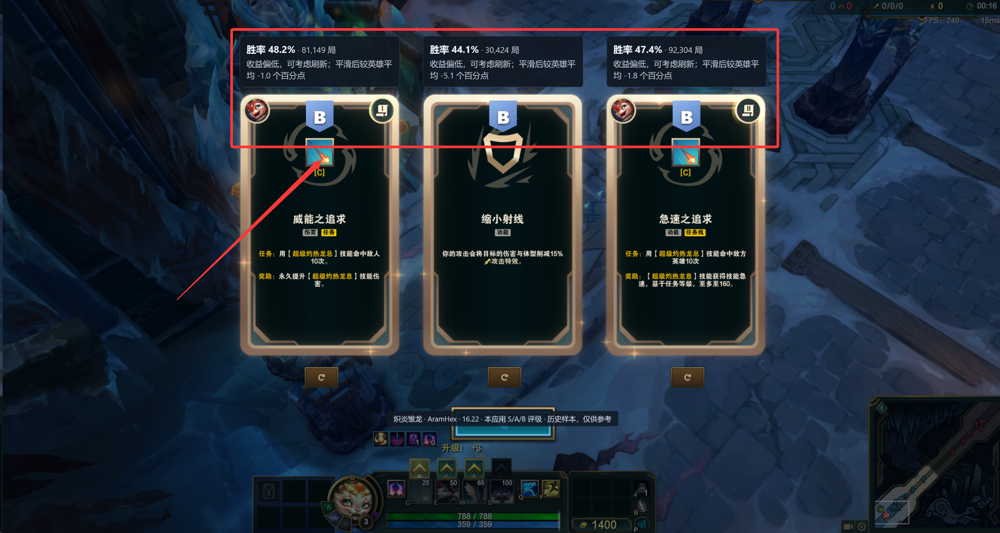
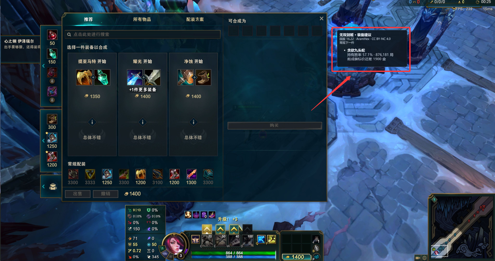

# 海克斯大乱斗小助手

简体中文 Windows 桌面助手，为《英雄联盟》国服海克斯大乱斗提供选人排名、阵容参考、海克斯评级和商店出装建议。应用启动后常驻系统托盘，游戏状态读取和画面识别都在本机进行。

> 当前发布：v0.1.3 免安装版。安装器暂不发布。逐条更新内容见 [更新记录](CHANGELOG.md)。
>
> v0.1.3 免安装版已包含英雄能力标签、阵容建议和商店出装浮层。

## 下载与启动

**[下载 v0.1.3 免安装压缩包](https://github.com/yeliwei01994/hextech-aram-assistant/releases/download/v0.1.3/HextechAramAssistant-0.1.3-portable.zip)**

1. 下载 ZIP 并完整解压到一个固定文件夹，不要直接在压缩包里运行。
2. 双击 `aram-companion.exe`。
3. 应用会在后台托盘运行；右键托盘图标打开设置或退出。

不需要安装 Node.js、pnpm、Rust 或 Python。OCR 运行组件已包含在压缩包内。Windows 11 和大多数 Windows 10 电脑已带有 WebView2；若程序提示缺少，可[从微软安装 WebView2 Runtime](https://go.microsoft.com/fwlink/p/?LinkId=2124703)。

## 功能预览

### 选人阶段：英雄排名、能力标签与阵容参考

自动读取己方五个位置和备选英雄池。己方英雄旁显示国服胜率、名次和能力标签，备选池显示名次和档位。1–5 档是本应用将 AramHex 胜率名次五等分得到的档位，1 档最高。

#### 英雄标签怎么评估

内置名册的 173 名英雄均有六项档案。标签由项目按海克斯大乱斗中的技能用途人工维护，支持数字 ID、英文 ID、中文名和称号匹配。

| 能力 | 评估内容 |
| --- | --- |
| 清线 | 能否稳定处理兵线，帮助队伍守塔或推进。 |
| 远程消耗 | 能否在正式交战前从远距离持续压低对方血量。 |
| 开团 | 能否主动发起团战，让队友有机会跟进。 |
| 反手保护 | 能否用控制、击退、护盾或救援保护队友。 |
| 前排承伤 | 能否顶住第一波伤害，给队友留出输出空间。 |
| 主要伤害类型 | 分为物理、魔法、混合和随出装变化。 |

前五项分为主要、条件性、弱或无。浮层展示主要能力和条件性能力。条件性能力可能依赖技能、出装或进场时机，计算时按半份能力计入。新增英雄如果没有档案，会显示「能力待评估」。

#### 换人建议怎么算

1. 确认自己的英雄在己方阵容中的位置，逐个模拟用备选英雄替换自己。
2. 比较换人前后的能力。规则会考虑补清线、补消耗、补开团、补反手、补承伤，以及补另一种主要伤害。消耗已充足时，反手保护的权重更高。
3. 检查换人是否让原本具备的关键能力跌破保留门槛，或失去唯一明确的物理或魔法输出来源。未知项会限制依赖该能力的判断。
4. 选出规则评分最高的备选英雄，评分相同再比较国服单英雄胜率名次。没有明确改善时，浮层显示「暂无明确换人建议」。

**英雄标签和阵容建议仅供参考，仍有优化空间。** 标签、权重和门槛是人工判断，尚未用国服五人阵容对阵数据校准。建议说明换人可能补上什么，无法量化换人对本局胜率的影响。

### 对局阶段：海克斯 S / A / B 推荐

本地识别海克斯卡片，在卡片上方显示本应用 S/A/B 评级、原始胜率、样本局数与统计建议。样本少或没有可靠数据时会明确提示；刷新卡片后会根据画面变化重新识别。

<p align="center">
  
</p>

### 对局阶段：打开商店自动显示出装建议

助手从游戏画面识别商店，确认打开后在右侧显示装备浮层。关闭商店后自动隐藏。浮层支持鼠标穿透，购买和搜索仍在游戏商店内完成。

<p align="center">
  
</p>

#### 推荐装备怎么算

- **候选数据**来自 AramHex 国服常规模式的英雄 × 成装持有统计。读取装备名称、标价和合成关系，并筛除少于 300 局、标记为低样本或数据无效的记录。
- **常规下一件**优先排除背包里已经持有的成装。候选取持有局数最高的前八件，并保留达到第一名持有局数 20% 的装备。候选中优先显示能接上更多种已有直接散件的装备，散件数量相同时再按持有局数排序。
- **本局针对装**尝试从本机对局接口读取敌方英雄。命中手工维护的回复、护盾或前排规则时，会在有足够样本的候选里考虑重伤、破盾或穿透，并显示理由。没有可靠名单或合适的候选时，仍可显示常规成装参考。
- **金币提示**使用当前金币与成装标价比较。匹配到已有散件时，浮层提示可以接散件，实际合成费用以游戏商店为准。

**装备推荐仅供参考，仍有优化空间。** 持有胜率是历史样本中对局结束时持有该装备的胜率，不能用来推断首件顺序或本局购买后的胜率。装备排序、散件匹配和敌方威胁规则仍可改进。部分显示模式、商店位置和缩放也可能影响浮层识别。

## 使用说明

- 推荐将游戏显示模式设为**无边框**，独占全屏可能遮挡游戏内浮层。
- 快捷键：`Ctrl + Shift + F6` 手动识别海克斯，`Ctrl + Shift + F7` 刷新英雄状态，`Ctrl + Shift + F8` 隐藏海克斯提示。
- 关闭设置窗口会将应用隐藏回托盘；要完全退出，请右键托盘图标并选择“退出”。
- 解压后的程序文件夹可放在任意固定位置。卸载时退出应用并删除该文件夹；本地设置和数据保存在 Windows 用户目录中。

## 从源码运行

开发环境需要 Windows 10/11 x64、Node.js、pnpm、Rust stable、Visual Studio C++ Build Tools、WebView2 Runtime 和 Python 3.12。

双击仓库根目录的 `启动开发版.bat` 即可启动 Tauri 开发版。脚本会检查 Node.js 和 pnpm；缺少本地前端依赖时，会按锁文件安装后再启动。

也可以手动运行：

```powershell
pnpm.cmd install
pnpm.cmd tauri dev
```

构建免安装压缩包：

```powershell
pnpm.cmd package:windows:portable
```

压缩包输出到 `outputs/HextechAramAssistant-版本号-portable.zip`。

## 数据与隐私

- 默认统计来源为 [AramHex 数据仓库](https://github.com/czgreat/aramhex-data)，采用国服全体样本、常规规则；内置离线快照，启动时及每 6 小时检查更新，失败后 15 分钟重试。
- 统计数据采用 CC BY-NC 4.0，需署名、仅限非商业使用。S/A/B 是本应用计算的评级，不是来源官方等级；方法与局限见 [数据说明](docs/data-sources.md)。
- 选人状态、局内敌方英雄、背包和金币通过本机游戏接口读取。海克斯和商店画面也在本机处理，游戏截图不会上传。选人浮层和商店建议使用本地规则。
- AI 阵容分析默认关闭；启用并手动触发后，才会将敌方英雄名称和手动威胁标签发送到用户配置的 API 服务。
- 本项目为社区工具，与 Riot Games、腾讯或 AramHex 无隶属关系。游戏及数据相关权利归其各自所有者。
